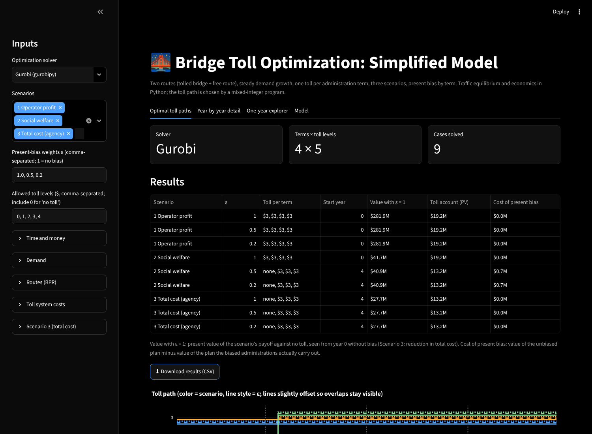

# Bridge Toll Optimization: Streamlit dashboard (simplified model)



A web dashboard for the simplified bridge-toll model (`Bridge_Toll_Simplified_Model.docx`).
You enter the parameters in the sidebar; Python solves the traffic equilibrium and the yearly
economics, and an optimization solver picks the toll for each administration term in the background.

## Files

| File | What it is |
|---|---|
| `app.py` | The Streamlit dashboard (inputs, charts, CSV downloads) |
| `toll_model.py` | The model: two-route equilibrium, yearly economics, three scenarios, present bias, and the toll MIP for Gurobi / Pyomo + HiGHS / CPLEX (plus enumeration as a check) |
| `verify_worked_example.py` | Checks every installed solver against the worked example in Section 9 of the model document |
| `requirements.txt` | Python packages |
| `.streamlit/config.toml` | Black background, white text theme |

## Run it (Windows, macOS or Linux)

Needs Python 3.10 or newer.

```bash
cd streamlit_app
python -m venv .venv
# Windows:  .venv\Scripts\activate        macOS/Linux:  source .venv/bin/activate
pip install -r requirements.txt
streamlit run app.py
```

The dashboard opens at http://localhost:8501. To check the solvers first: `python verify_worked_example.py`.

## Solvers

Pick the solver in the sidebar. Only the ones installed on the machine are listed.

* **Gurobi (`gurobipy`)**: `pip install gurobipy` includes a free size-limited license, which is
  large enough for this model. With an academic license (free at gurobi.com for FAMU), it uses that instead.
* **Pyomo + HiGHS**: fully open source, no license needed.
* **IBM CPLEX (`docplex`)**: `pip install cplex docplex` gives the size-limited Community Edition,
  enough for this model. A full CPLEX (IBM Academic Initiative) also works.
* **Enumeration**: tries every toll path. No solver needed; used to check the MIP.

You can remove any solver line from `requirements.txt` you don't want; the app falls back to what is installed.

## What the dashboard shows

1. **Optimal toll paths**: for each scenario and present-bias weight ε, the toll per term, start year,
   value with ε = 1, toll account, and the cost of present bias. Toll-path and value charts. CSV download.
2. **Year-by-year detail**: for one case, money, bridge traffic, peak-hour route split, traveler costs
   against no toll, and the scenario payoff. CSV download for the case or for all cases.
3. **One-year explorer**: pick a year and a toll to see the equilibrium and each scenario's payoff as the toll varies.
4. **Model**: the equations and the MIP.

## How the optimization works

The traffic equilibrium (elastic demand, BPR travel times) is solved in Python by bisection for every
year and toll level. The toll choice is then a small mixed-integer program: binary `x[k, j] = 1` if
term k charges toll level j, one level per term, once tolling starts it continues, and the capital
cost is paid in the start term. Scenario 3 adds the finance constraint (net toll revenue covers the
toll system and the services). With ε < 1, each administration re-solves the MIP when it takes office,
with the earlier terms fixed, and keeps only its own term (the naive administration).

## Put it online as a website (free)

The app is ready for **Streamlit Community Cloud**, which runs it 24/7 at a public link such as
`https://bridge-toll.streamlit.app`. Everything runs on their server, so visitors need nothing installed.

1. **Make a GitHub repository.** Sign in at github.com → **New repository** → name it e.g. `bridge-toll-dashboard`
   (public is simplest) → **Create** → **uploading an existing file** → drag in everything in this folder,
   *including the `.streamlit` folder* → **Commit changes**.
   (On Windows, hidden-looking folders like `.streamlit` still upload if you drag the whole folder contents.)
2. **Deploy.** Go to https://share.streamlit.io → **Continue with GitHub** → **Create app** →
   **Deploy a public app from GitHub** → pick the repository, branch `main`, main file `app.py` →
   (optional) choose a custom subdomain → **Advanced settings: Python 3.12** → **Deploy**.
3. First start takes 3–5 minutes while it installs the packages. After that, share the link.
   Every change you commit to GitHub updates the website automatically.

**Solvers online:** Pyomo + HiGHS is open source and always works. Gurobi and CPLEX install with their free
size-limited licenses, which are large enough for this model, so they also work online. Your FAMU academic
Gurobi license is tied to your own computer and is not needed for the website. If a solver ever fails to
install online, delete its lines from `requirements.txt`; the dashboard lists only the solvers it finds.
